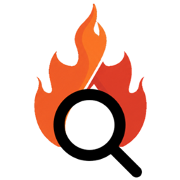
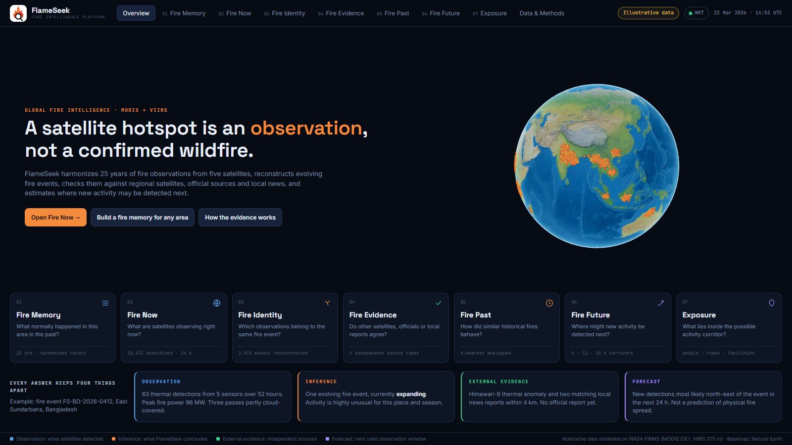
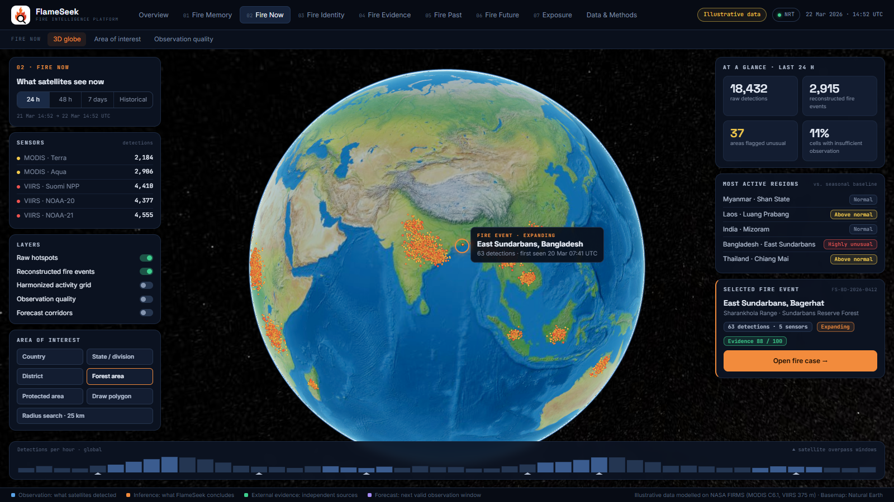
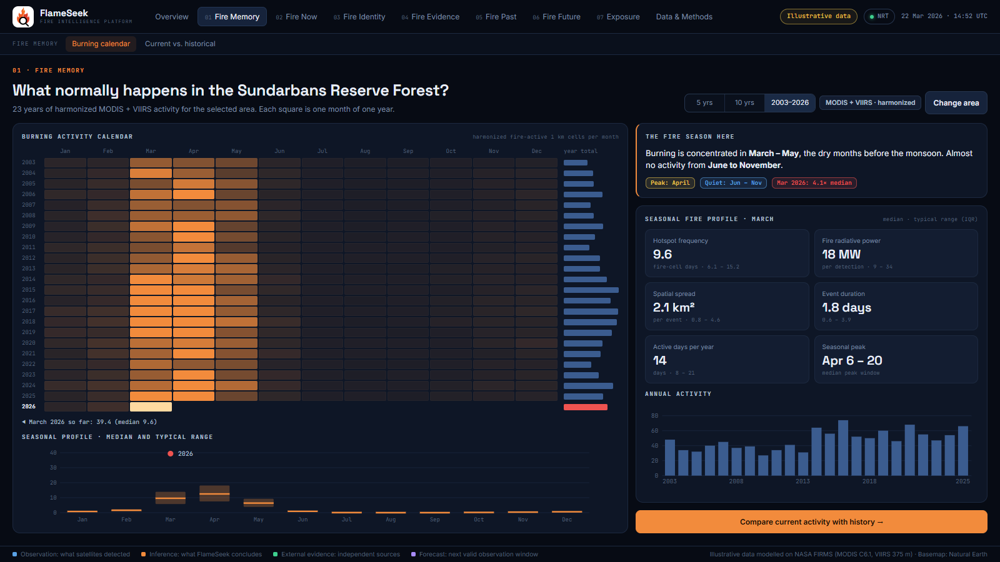
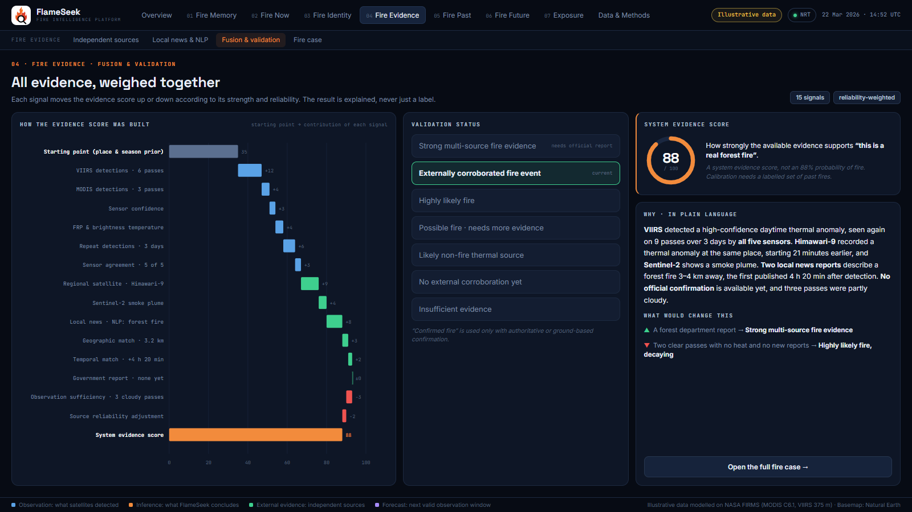
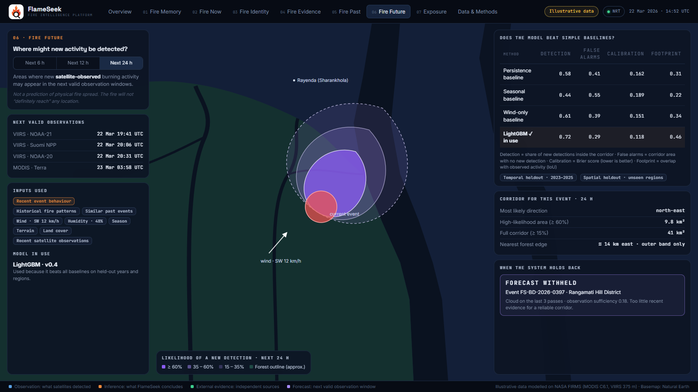

<p align="center"></p>

# FlameSeek

A fire intelligence platform built on NASA MODIS and VIIRS active-fire observations, made for the NASA Space Apps Challenge.

**Past → Present → Identify → Verify → Compare → Forecast → Exposure**

A satellite hotspot is an observation, not automatically a confirmed wildfire, and the absence of a hotspot is not proof that no fire exists. FlameSeek harmonizes fire observations from five satellites, reconstructs evolving fire events, checks them against regional satellites, official sources and local news, and estimates where new activity may be detected next.

Every answer keeps four things apart:

| Layer | Meaning |
|---|---|
| **Observation** | What the satellites actually detected (sensor, time, footprint, fire power, confidence) |
| **Inference** | What FlameSeek concludes (harmonized activity, anomalies, events, behaviour, evidence status) |
| **External evidence** | What independent satellites, agencies and news report |
| **Forecast** | Where new satellite-observed activity may appear in the next 6–24 h, or `FORECAST WITHHELD` |



## What is in this repository

| Part | State |
|---|---|
| `frontend/` | The app you see when you run the project: 16 screens that walk through the seven-stage story for one scripted fire event. All figures, charts, maps and news items are **illustrative** and built into the frontend. It makes no API calls. |
| `backend/` | A FastAPI service that implements the real pipeline on live NASA FIRMS data (harmonization, fire cases, evidence, analogues, forecast, exposure). It runs and has tests, but the current screens are **not connected** to it. |
| `frontend/src/pages`, `components`, `api` | The earlier live UI that talks to the backend. Kept in the tree, not routed. |
| `screenshots/` | `screenshots/demo/` holds the 16 current screens; the files directly in `screenshots/` are from the earlier live UI. |

## Running it

```bash
cd frontend
npm install
npm run dev          # http://127.0.0.1:5173
```

That is all the current app needs. Node 18+ is enough; no keys, tokens or backend are required. The globe uses Cesium's bundled Natural Earth imagery. Fonts load from Google Fonts and fall back to system fonts offline.

`npm run build` type-checks and produces a production bundle in `frontend/dist/`.

## The screens

The example followed throughout is fire event `FS-BD-2026-0412` in the East Sundarbans (Sharankhola Range, Bagerhat, Bangladesh), dated 20–22 March 2026.

| Nav | Screen | Route | What it shows |
|---|---|---|---|
| Overview | Seven-stage story | `/` | The seven stages and the four-layer answer for the example event |
| 01 Fire Memory | Burning calendar | `/fire-memory` | Month × year activity calendar 2003–2026, seasonal profile, annual activity |
| | Current vs. historical | `/fire-memory/anomaly` | This season against the median and MAD bands, anomaly category, change point |
| 02 Fire Now | 3D globe | `/fire-now` | Hotspots on a globe, sensors, layers, most active regions, selected event |
| | Area of interest | `/fire-now/area` | Choosing a country, division, district, forest, protected area, polygon or radius |
| | Observation quality | `/fire-now/quality` | Per-cell observation status and a cell inspector with its sufficiency score |
| 03 Fire Identity | Event reconstruction | `/fire-identity` | 63 detections grouped into one event, linked detections, behaviour state |
| 04 Fire Evidence | Independent sources | `/fire-evidence` | Regional satellites, official sources, geographic and temporal matching |
| | Local news & NLP | `/fire-evidence/news` | Matched and rejected reports, entity extraction, event classification |
| | Fusion & validation | `/fire-evidence/fusion` | How the evidence score of 88 is built, validation status, plain-language reason |
| | Fire case | `/fire-evidence/case` | The eight-panel summary of the whole case |
| 05 Fire Past | Historical analogues | `/fire-past` | Five closest past events and their fire-power curves |
| 06 Fire Future | Forecast corridor | `/fire-future` | 6 / 12 / 24 h corridor, model vs. baselines, a withheld forecast |
| 07 Exposure | Exposure analysis | `/exposure` | People, roads, farms, schools and facilities in or near the corridor |
| Data & Methods | Full workflow | `/methods` | The pipeline from raw hotspot to explained answer, and the data sources |
| | Sensor harmonization | `/methods/harmonization` | Spatial harmonization, sensor calibration, raw vs. harmonized record |

| | |
|---|---|
|  |  |
|  |  |

### What responds to input

Navigation and sub-tabs, the time-period and forecast-horizon switches, the year span on the burning calendar, the area-type picker, analogue selection on Fire Past, and the layer list on Exposure all change what is shown. A few controls only change their own state: the layer toggles on Fire Now, the tabs on the fire case map, and article selection on the news screen. "Download evidence report" opens the browser's print dialog.

## Frontend layout

```
frontend/
  index.html              fonts, favicon
  public/logo.png         project logo (header and browser tab)
  public/cesium/          Cesium static assets, including Natural Earth imagery
  src/main.tsx            routes
  src/demo/
    demo.css              theme and layout
    ui.tsx                app shell (header, sub-tabs, footer), cards, chips, small SVG chart helpers
    data.ts               the scripted event, calendar, hotspots, Bangladesh outline
    maps.tsx              schematic Bangladesh and Sundarbans maps, forecast corridor
    DemoGlobe.tsx         Cesium globe with scripted hotspots
    pages/                one file per nav section
```

Stack: React 18, TypeScript, Vite, React Router, Cesium. Charts are hand-written SVG. To change the story, edit `data.ts` and the constants at the top of each page file.

## Limits of the current app

- Nothing on screen is computed from real observations. The header carries an "Illustrative data" badge for that reason. News headlines, outlets, official statements and all figures are invented.
- The Bangladesh outline, the Sundarbans map and the positions of villages, roads and camps are hand-drawn schematics, not survey data.
- The layout is designed for desktop widths (about 1200 px and up); it is not responsive for phones.

## Backend: the live pipeline

The backend is independent of the current screens. It is the working implementation of the methods the screens describe.

```bash
cd backend               # Python 3.11+
pip install -r requirements.txt
python -m uvicorn main:app --host 127.0.0.1 --port 8003
python -m pytest
```

Port 8003 is the one the Vite dev server proxies `/api` to (`frontend/vite.config.ts`). Interactive API docs are at `/docs`.

`backend/.env`:

```env
FIRMS_MAP_KEY=your_nasa_firms_key      # required: https://firms.modaps.eosdis.nasa.gov/api/map_key/
NEWS_API_KEY=your_newsapi_key          # optional: adds NewsAPI articles to GDELT
```

All other data sources are free and keyless. Responses are cached under `backend/cache/`; FIRMS science archives are cached permanently, so the first Fire Memory or event outlook for an area takes minutes and later runs take seconds. The FIRMS key allows 5000 transactions per 10 minutes. The backend reads the key's live usage: interactive requests fail fast with a clear message when the budget is nearly spent, and long jobs wait for the window to roll over. When FIRMS is slow or unreachable, the backend serves its cached data and marks it as a fallback.

To use the earlier live UI with it, restore its routes in `frontend/src/main.tsx` (`HomePage`, `FireGlobePage`, `FireMemoryPage`, `DataSourcesPage`, wrapped in `AppProvider`, with `styles.css` imported). `frontend/.env.local` then accepts `VITE_API_BASE_URL`, `VITE_CESIUM_ION_TOKEN` (terrain and imagery) and `VITE_GOOGLE_MAPS_API_KEY` (photorealistic tiles).

### Four-Witness Fire Intelligence

The fire satellites (Terra and Aqua MODIS, Suomi NPP, NOAA-20 and NOAA-21 VIIRS) are treated as witnesses with known blind spots.

**Harmonization (`witness.py`)** runs eight stages:

1. Detections from FIRMS, with observation opportunities from sensor availability and ERA5 cloud cover.
2. Vegetation fires only (FIRMS `type` 0), confidence filter, local solar time, pixel area, 0.1° cell.
3. MODIS same-overpass duplicates within 1 km merged (higher FRP kept); 375 m VIIRS pixels grouped into ~1 km clusters.
4. A **sensor detection profile**, P(MODIS detects | VIIRS FRP, pixel area), learned by logistic regression on Aqua/S-NPP matchups within 20 minutes (pre-drift years first), plus the MODIS/VIIRS FRP relation. Falls back to the Li et al. (2020) prior (50% at 4.3 MW nadir, 31.7 MW scan edge).
5. A daily fire curve fitted from Terra/Aqua and VIIRS day/night ratios (per month where data allow). Every observation is converted to its Aqua 13:30 equivalent, which also removes orbit-drift artifacts.
6. **Two tiers.** The *consistent record* (MODIS sensitivity, 2000 to now) drives the calendar, trends and anomalies. The *detailed layer* (every VIIRS detection) drives the globe.
7. Activity per **clear-sky look**: swath width / ground-track spacing at the latitude × clear fraction. This fixes equator gaps, polar over-sampling and cloudy days.
8. A **fused fire probability** per cell and local day. It starts from the cell's historical rate for that month; each detection raises the odds and each clear miss lowers them, weighted by that witness's detection chance; cloudy looks are ignored.

Fire Memory reports the **continuity test** (raw vs consistent ratio across the 2012 and 2018 sensor starts) and the **hide-one-witness test** (remove NOAA-20, then check how well the fused probability predicts its detections: AUC and Brier vs the historical rate alone).

**Fire Cases (`fire_case.py`, `overpass.py`)** open a case for every event and gather evidence from three streams into one time-ordered evidence block:

- **Stream A:** later polar passes. They are predicted with skyfield from current TLEs and classified as seen stronger/weaker, spread, clear miss, cloud/smoke or not covered.
- **Stream B:** GOES start/duration/end; Himawari and Meteosat as review links.
- **Stream C:** NLP-matched news and official reports.
- **Background facts:** land use, nearby heat sources, the local burning season and repeat heat on the same spot over the previous five years.

Each item votes for categories weighted by its reliability. The answer has three parts: **Is it real? What kind? What is it doing now?** A type is named only when the top category scores above 50% and leads the next by 20 points. Cases stay provisional until every satellite has passed or 24 h have elapsed.

### Scripted backend scenarios

`backend/demo_data.py` scripts three complete Fire Cases in Bangladesh: a garment factory fire at Ashulia (Dhaka), paddy-straw burning at Shibganj (Bogura) and a forest fire in the Sundarbans' Chandpai range. `backend/demo_outlook.py` scripts the Past, Future and Exposure results for the same three fires. They are synthetic, need no external calls, and results carry `demo_scenario`. Edit `SCENARIOS` to change a story, or empty the list to run on live data only.

### Where each capability lives

| Capability | Implementation |
|---|---|
| MODIS/VIIRS integration, sensor harmonization | `firms_client.py` (NRT and science archives, GOES, Landsat), `witness.py` (detection profile, time of day, two tiers, effort, fused probability), `harmonize.py` (daily series and anomalies on the consistent record) |
| Fire Cases | `fire_case.py` (streams A/B/C, category votes, decision rules, three-part answer), `overpass.py` (skyfield + CelesTrak TLEs) |
| Footprint-aware mapping | `geo.py`: FIRMS scan × track footprints, fractional attribution to the ~1 km grid, location uncertainty |
| Observation quality | `quality.py`: six observation classes, Observation Sufficiency Score, `UNKNOWN` / `AMBIGUOUS` / `INSUFFICIENT OBSERVATION`, provenance |
| Area of interest | `geo.AOI`, `geocode.py`: country, state, district, forest or protected-area search (OSM Nominatim), rectangle, polygon, radius |
| Calendar, seasonal profile, current vs historical | `routers/memory.py`, `seasonal.py` |
| Anomalies | Robust median/MAD z: Normal, Above Normal, Unusual, Highly Unusual |
| Change points | `changepoint.py`: PELT, reported as *statistically detected changes* |
| Fire events and behaviour | `events.py`: spatio-temporal linking, event attributes, association confidence, inferred behaviour states |
| Reverse geocoding | `geocode.py`: country to village, nearest settlement, forests and protected areas, nearby non-fire heat sources |
| Regional satellites | `corroboration.py`: other MODIS/VIIRS platforms, GOES (Americas), Landsat (US/CA), Sentinel-2 scenes, EFFIS (Europe/MENA), CWFIS M3 (Canada); Himawari and Meteosat as review links |
| Government sources | GDACS (global), NIFC WFIGS (US, including prescribed burns), NSW RFS; per-country agency directory (`source_directory.py`) |
| News, NLP, geographic and temporal matching | `evidence.py`, `nlp.py`: GDELT (plus optional NewsAPI), event-type classification, cause, impact, area, infrastructure; distance and time-to-detection scoring |
| Fusion, status, score, explanation | `evidence.fuse`: component breakdown, status labels, generated explanation |
| Historical analogues | `history.py`, `analogues.py`: same-age truncation, KNN with shrinkage-regularized Mahalanobis distance, outcomes |
| Forecast | `forecast.py`: persistence, seasonal and wind-only baselines vs LightGBM on temporal and spatial holdouts (Brier, BSS, POD, FAR, CSI, footprint IoU, calibration); probability corridor or `FORECAST WITHHELD` |
| Exposure | `exposure.py`: WorldPop population and OSM settlements, roads, farmland, forests, protected areas, schools, hospitals, power, critical facilities |

### API

`GET /api/current_hotspots` · `GET /api/events` · `GET /api/events/{id}` · `GET /api/events/{id}/case` · `POST /api/events/{id}/evidence` (job, includes the Fire Case) · `POST /api/events/{id}/outlook` (job: analogues, forecast, exposure) · `POST /api/fire_memory` (job) · `GET /api/jobs/{id}` · `GET /api/places/search` · `GET /api/places/reverse` · `POST /api/generate_calendar` · `POST /api/critical_periods` · `GET /api/verified_hotspots` · `GET /data-sources`.

### Honest limits of the pipeline

- **Evidence score** weights are expert-set, so the score is evidence strength, not a probability. "Confirmed Fire" is used only when an official incident report lies within 15 km and matches in time, and no controlled burn is reported.
- **Cloud cover** comes from ERA5 reanalysis and is a proxy for the satellites' own cloud masks.
- **NLP** is transparent rule-based extraction, not a trained language model. News summaries are generated from extracted facts and are labelled as system-generated.
- **Himawari, Meteosat and most national agencies** have no public machine-readable fire feed, so they are linked for manual review and never counted as checked.
- **Forecasts** predict *satellite-observed activity*, not fire spread. They do not use land cover or fuel moisture. Training uses reanalysis winds for the forecast window (perfect-prognosis), so live skill may be lower than the holdout scores. When the chosen model's skill against climatology is negative, the result says so.
- **Observation effort** uses orbit geometry and ERA5 cloud, not the MOD14A1/MYD14A1/VNP14A1/VJ114A1 daily masks (these need an Earthdata login). Detection profiles are regional and learned per area; land cover is not a profile input because FIRMS carries none.
- **Fire Case category percentages** are evidence scores, not calibrated probabilities, until they are tested on labelled cases. A clear miss after a short burn is weak evidence, and a missing news report is weaker still.
- **Fire Memory** accepts areas up to 20° across. Histories longer than about 10 years make thousands of FIRMS requests the first time.
- **Known bug:** `GET /api/verified_hotspots` currently returns HTTP 500 (a response-serialization error raised from the handler in `routers/analysis.py`).
