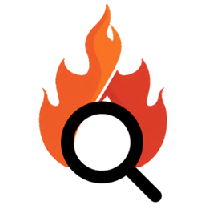

<p align="center"></p>

# FlameSeek

A fire intelligence platform built on NASA MODIS and VIIRS active-fire observations, made for the NASA Space Apps Challenge.

**Past → Present → Identify → Verify → Compare → Forecast → Exposure**

A satellite hotspot is an observation, not automatically a confirmed wildfire, and the absence of a hotspot is not proof that no fire exists. FlameSeek harmonizes fire observations from five satellites, reconstructs evolving fire events, checks them against regional satellites, official sources and local news, and estimates where new activity may be detected next.

Every answer keeps four things apart:

| Layer | Meaning |
|---|---|
| **Observation** | What the satellites actually detected (sensor, time, footprint, fire power, confidence) |
| **Inference** | What FlameSeek concludes (harmonized activity, anomalies, events, behaviour, evidence status) |
| **Outlook** | A recurrence-based 8-week outlook from the calendar |

## What is in this repository

| Part | State |
|---|---|
| `frontend/` | React app: the Burning Calendar (weekly calendar for any area of interest) and Sources & Methods. No scripted data. |
| `backend/` | FastAPI service that harmonizes archived NASA FIRMS MODIS/VIIRS records into a consistent multi-decade series (calendar, anomalies, change points). The project is history-only: live detections, fire cases, evidence, analogues, forecasts and exposure were removed. |

## Running it

Start the backend (see below), then:

```bash
cd frontend
npm install
npm run dev          # http://127.0.0.1:5173, proxies /api to port 8003
```

`frontend/.env.local` accepts `VITE_API_BASE_URL`. `npm run build` type-checks and bundles.

## Fire Memory: the weekly calendar

Choose a place (search, draw, or polygon) and a look-back of 5 to 25 years. The backend downloads MODIS and VIIRS archives, harmonizes them and returns a daily series; the frontend (`utils/weekly.ts`, `components/WeeklyCalendar.tsx`) turns it into:

- a **52-week × years heatmap** of harmonized activity or FRP; click a square for the week's detections, sensor agreement and observation quality;
- **anomalies**: z-score of each week against the rolling mean and standard deviation of the same week in earlier years (at least 3), flagged at z ≥ 2.0;
- a **predictive horizon** for the next 8 weeks: how often each upcoming week reached notable burning in earlier years, adjusted by the recent z-scores. This is a recurrence baseline for the whole area, not the ConvLSTM/XGBoost grid forecast, and it uses no weather covariates yet.

Not yet implemented: Himawari diurnal refinement, NLP attribution of calendar weeks to local news, and per-0.1° forecast cells. The drawer says so instead of showing placeholder text.

## Backend: the live pipeline

The backend is independent of the current screens. It is the working implementation of the methods the screens describe.

```bash
cd backend               # Python 3.11+
pip install -r requirements.txt
python -m uvicorn main:app --host 127.0.0.1 --port 8003
python -m pytest
```

Port 8003 is the one the Vite dev server proxies `/api` to (`frontend/vite.config.ts`). Interactive API docs are at `/docs`.

`backend/.env`:

```env
FIRMS_MAP_KEY=your_nasa_firms_key      # required: https://firms.modaps.eosdis.nasa.gov/api/map_key/
NEWS_API_KEY=your_newsapi_key          # optional: adds NewsAPI articles to GDELT
```

All other data sources are free and keyless. Responses are cached under `backend/cache/`; FIRMS science archives are cached permanently, so the first Fire Memory or event outlook for an area takes minutes and later runs take seconds. The FIRMS key allows 5000 transactions per 10 minutes. The backend reads the key's live usage: interactive requests fail fast with a clear message when the budget is nearly spent, and long jobs wait for the window to roll over. When FIRMS is slow or unreachable, the backend serves its cached data and marks it as a fallback.


### Four-Witness Fire Intelligence

The fire satellites (Terra and Aqua MODIS, Suomi NPP, NOAA-20 and NOAA-21 VIIRS) are treated as witnesses with known blind spots.

**Harmonization (`witness.py`)** runs eight stages:

1. Detections from FIRMS, with observation opportunities from sensor availability and ERA5 cloud cover.
2. Vegetation fires only (FIRMS `type` 0), confidence filter, local solar time, pixel area, 0.1° cell.
3. MODIS same-overpass duplicates within 1 km merged (higher FRP kept); 375 m VIIRS pixels grouped into ~1 km clusters.
4. A **sensor detection profile**, P(MODIS detects | VIIRS FRP, pixel area), learned by logistic regression on Aqua/S-NPP matchups within 20 minutes (pre-drift years first), plus the MODIS/VIIRS FRP relation. Falls back to the Li et al. (2020) prior (50% at 4.3 MW nadir, 31.7 MW scan edge).
5. A daily fire curve fitted from Terra/Aqua and VIIRS day/night ratios (per month where data allow). Every observation is converted to its Aqua 13:30 equivalent, which also removes orbit-drift artifacts.
6. **Two tiers.** The *consistent record* (MODIS sensitivity, 2000 to now) drives the calendar, trends and anomalies. The *detailed layer* (every VIIRS detection) drives the globe.
7. Activity per **clear-sky look**: swath width / ground-track spacing at the latitude × clear fraction. This fixes equator gaps, polar over-sampling and cloudy days.
8. A **fused fire probability** per cell and local day. It starts from the cell's historical rate for that month; each detection raises the odds and each clear miss lowers them, weighted by that witness's detection chance; cloudy looks are ignored.

Fire Memory reports the **continuity test** (raw vs consistent ratio across the 2012 and 2018 sensor starts) and the **hide-one-witness test** (remove NOAA-20, then check how well the fused probability predicts its detections: AUC and Brier vs the historical rate alone).

### Where each capability lives

| Capability | Implementation |
|---|---|
| MODIS/VIIRS integration, sensor harmonization | `firms_client.py` (science archives), `witness.py` (detection profile, time of day, two tiers, effort, fused probability), `harmonize.py` (daily series and anomalies on the consistent record) |
| Footprint-aware mapping | `geo.py`: FIRMS scan × track footprints, fractional attribution to the ~1 km grid, location uncertainty |
| Observation quality | `quality.py`: six observation classes, Observation Sufficiency Score, `UNKNOWN` / `AMBIGUOUS` / `INSUFFICIENT OBSERVATION`, provenance |
| Area of interest | `geo.AOI`, `geocode.py`: country, state, district, forest or protected-area search (OSM Nominatim), rectangle, polygon, radius |
| Calendar, seasonal profile, current vs historical | `routers/memory.py`, `seasonal.py` |
| Anomalies | Robust median/MAD z: Normal, Above Normal, Unusual, Highly Unusual |
| Change points | `changepoint.py`: PELT, reported as *statistically detected changes* |
| Reverse geocoding | `geocode.py`: country to village, nearest settlement, forests and protected areas, nearby non-fire heat sources |

### API

`GET /api/places/search` · `GET /api/places/reverse` · `POST /api/fire_memory` (job) · `GET /api/jobs/{id}` · `POST /api/generate_calendar` · `POST /api/critical_periods` · `GET /data-sources`.

### Honest limits of the pipeline

- **Cloud cover** comes from ERA5 reanalysis and is a proxy for the satellites' own cloud masks.
- **Observation effort** uses orbit geometry and ERA5 cloud, not the MOD14A1/MYD14A1/VNP14A1/VJ114A1 daily masks (these need an Earthdata login). Detection profiles are regional and learned per area; land cover is not a profile input because FIRMS carries none.
- **Fire Memory** accepts areas up to 20° across. Histories longer than about 10 years make thousands of FIRMS requests the first time.
