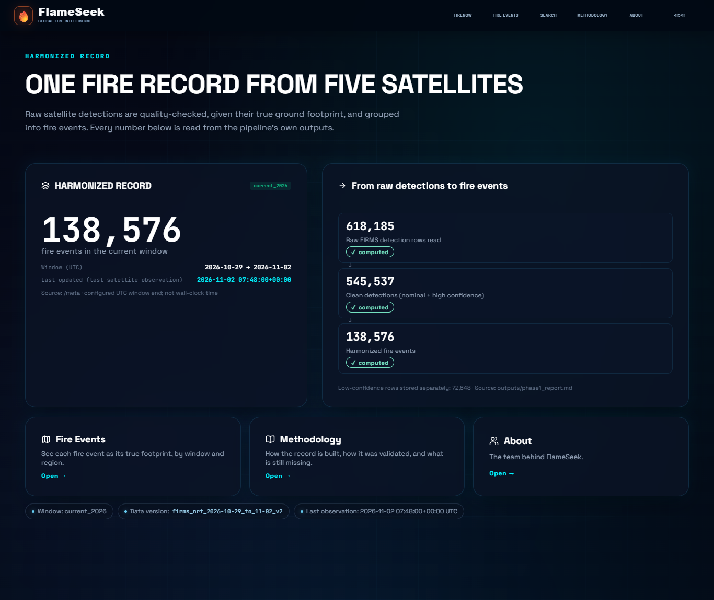
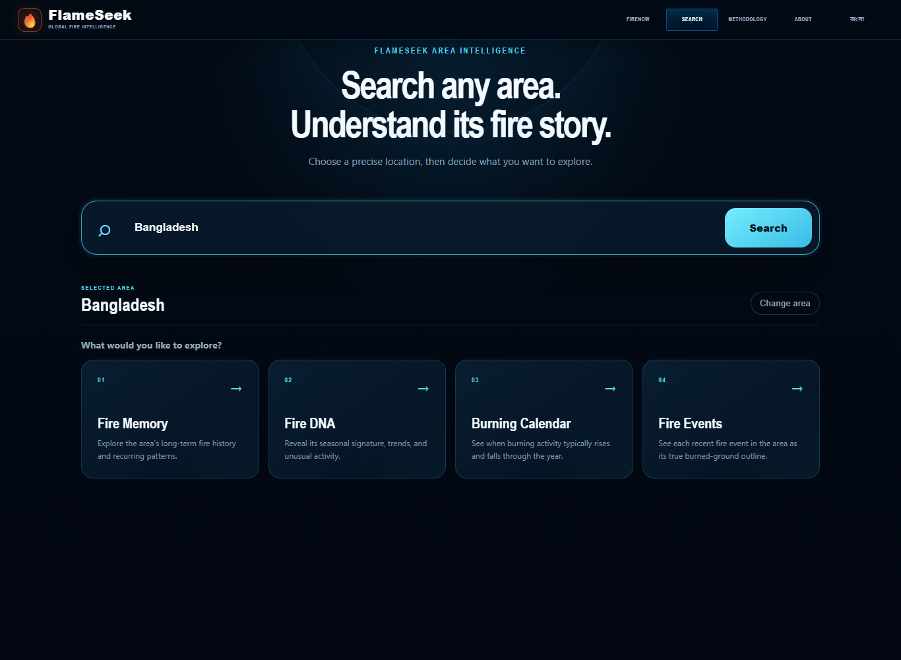
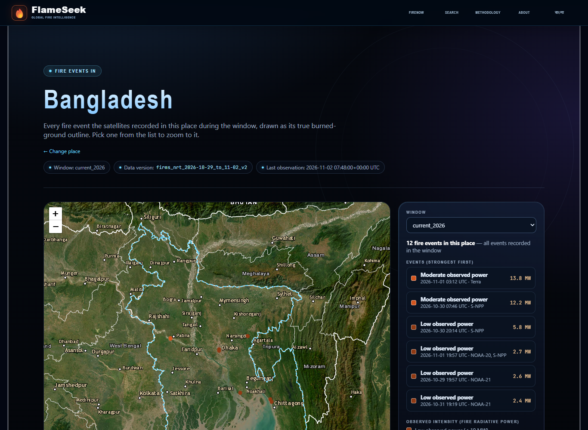
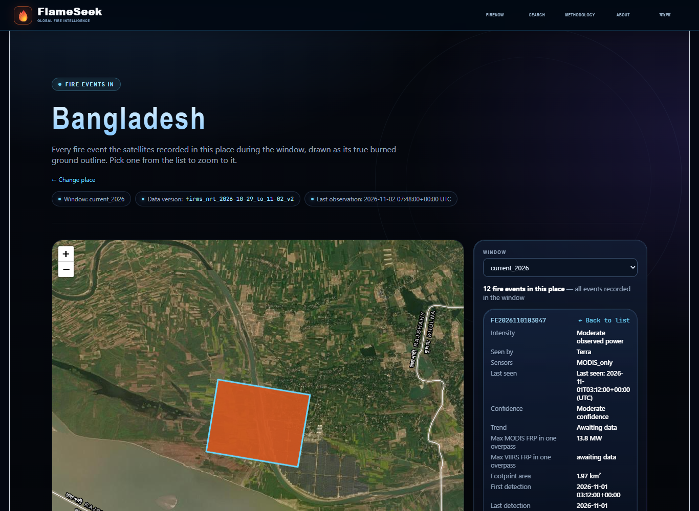
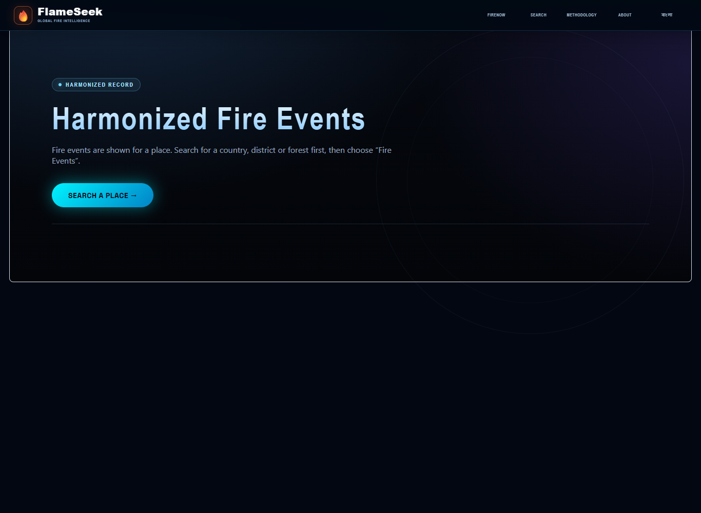
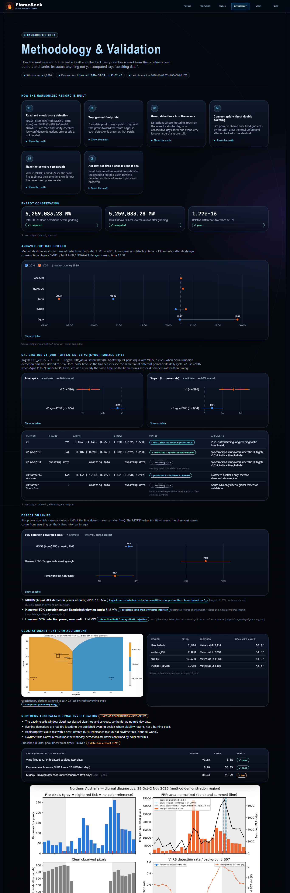
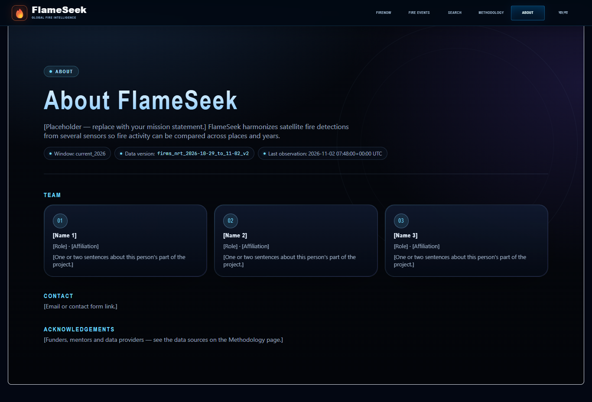

# FlameSeek website — harmonized record inside the existing site

Date: 2026-11-02. Decisions: D75 (data and API), D76 (integration) and D77 (Search flow) in
`docs/decisions.md`. Run instructions: README, "Harmonized record pages — run locally".

## What changed in this revision

The first version replaced the existing site with a separate light-themed one. That has
been removed:

- `frontend/src/site/` deleted;
- `main.tsx`, `vite.config.ts` and `package.json` restored from git;
- Home is back at `/`.

The harmonized-record work is now built inside the existing FlameSeek frontend, using its
own theme and page structure. Existing pages (Home, FireNow, Search, Fire Memory,
Fire DNA, Sources) are unchanged apart from small additive edits:

| File | Addition |
|---|---|
| `main.tsx` | 3 routes, 3 nav links, language toggle |
| `HomePage.tsx` | one new section |
| `vite.config.ts` | proxy entries for the snapshot API |

## Pages and navigation (after D77)

Header: **FireNow** (your live 3D globe; the main map) · Search · **Methodology** · **About** · **বাংলা**/EN.

| Page | How you get there | Built with |
|---|---|---|
| Home — "Harmonized Record" section | `/` | `oc-section`, `oc-dashboard-panel`, `oc-hud-row`; first card links to FireNow |
| Fire Events for a place | Search → choose a place → card **04 Fire Events** | `space-page` layout, glass cards, react-leaflet + Esri imagery |
| Methodology & Validation | header | `space-page` layout, `method-card` steps, Plotly charts |
| About (placeholder) | header | `space-page` layout, `method-card` team cards |

## Screenshots

All are in `outputs/website_screenshots/`, captured from the running dev server (port 5173). The Fire Events
images come from a scripted browser run: Search → "Bangladesh" → Fire Events → click the strongest event.

| View | File |
|---|---|
| Home, Harmonized Record section |  |
| Search with a place chosen; card 04 is Fire Events |  |
| Fire Events for Bangladesh: place outline, events, named list |  |
| Clicking an event: zoom to its true outline + details |  |
| Fire Events opened without a place: prompt to search |  |
| Methodology & Validation (full page) |  |
| About |  |

## Content (all numbers from files on disk, each with label and status)

**Home section**
- 138,576 fire events in current_2026 (`/meta`); window 2026-10-29 → 2026-11-02; last
  observation 2026-11-02 07:48 UTC.
- 618,185 raw rows → 545,537 clean detections → 138,576 events
  (`outputs/phase1_report.md`). The older batch figure, 138,518, is superseded.
- Cards link to Fire Events, Methodology and About.
- Provenance chips show the window, data version and last observation.

**Fire Events (for a searched place)**
- Every event of the window inside the place (Bangladesh: 12 events), from the new `/fires` endpoint.
- **Map:** the place's dashed outline, and each event drawn as its true burned-ground outline. Zoomed out,
  a small outline gets a thick border in its intensity colour so it stays visible. There are no stand-in dots.
- **Named list, strongest first:** intensity word, time, satellites, peak FRP. Clicking a row zooms to that
  fire's outline and shows its details: platforms, sensors, last seen, confidence, trend, max FRP per sensor,
  area, honesty notes.
- The honesty notes stay on the map; a window selector is included.

**Methodology**
- Six pipeline steps with "show the math".
- Energy conservation: 5,259,083.28 MW before and after; 1.77e-16; pass.
- Aqua drift chart: 13:27 (2016) → 15:48 (2026).
- Calibration v1 vs v2 charts and table. A one-sentence explanation of why they differ is
  generated from the measured drift.
- Detection limits:

  | Detection limit | Value |
  |---|---|
  | MODIS F50 at nadir, 2016 | 17.3 MW |
  | Himawari F50, Bangladesh | 71.9 MW |
  | Himawari F50, near nadir | 13.4 MW |

- Geostationary assignment map.
- Northern Australia investigation, marked "method demonstration – not applied".
- Awaiting-data list and data sources.

## Design and accessibility

- **Theme.** Uses the project's theme tokens (`--oc-*`, `--sp-*`, mission font), glass
  cards and pill eyebrows. The new stylesheet `src/harmonized.css` only adds layout for the
  new pieces.
- **Colours** were validated for the dark surface with the dataviz palette validator:
  - intensity ordinal ramp `#8f3a14 → #d4561f → #ff8a4c → #ffc78a` (brighter = more power);
  - chart pair `#3987e5` / `#d95926`.
- **Labels.** Every colour has a text label. Each chart has a hover tooltip and a
  "Show as table" view.
- **Provenance.** Each new page shows `data_version` and `last_observation_time`.
  Existing live-FIRMS pages are not stamped with snapshot provenance, because they show
  different (live) data.

## Tests and checks

- 129 harmonization and 74 backend tests pass (the `/fires` endpoint is tested).
- TypeScript type-check: 0 errors.
- All routes return 200 on the dev server, and the Search → Fire Events flow was run end-to-end in a browser.

## Known limits

- **Production build.** `npm run build` still could not be verified on this machine
  because of low free memory. It is not caused by these changes, which add no
  dependencies.
- **Leftover dev server.** A dev server from my earlier attempt still runs on port 5180
  (process 24928), serving the removed version. Stopping it was blocked by a permission
  check; close it from Task Manager, or run `Stop-Process -Id 24928` in PowerShell.
- **Bangla.** Bangla covers the new section and pages: interface chrome and fire
  descriptions. Text exported from data files stays English. The Bangla interface
  strings need native review.
